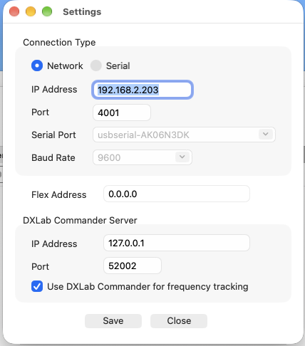
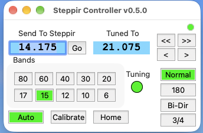
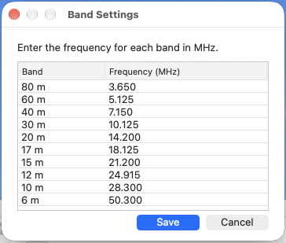

# Steppir Controller

Steppir Controller is a Xojo desktop application for controlling a SteppIR antenna controller from your computer. It has been tested on Macs with both SDA-100 and SDA-2000 controllers.

Connect directly to the controller's **Data Out** port using an appropriate serial cable, or connect over a network using a serial-to-TCP device. The application provides manual tuning, configurable band presets, antenna mode commands, and frequency tracking from FlexRadio or DXLab Commander.

## Requirements

- A compatible SteppIR controller and antenna. Available bands and modes depend on your hardware.
- An appropriate serial connection to the Data Out port, or a configured serial-to-TCP adapter.
- Optionally, a network-accessible FlexRadio or DXLab Commander server for frequency tracking.
- To run from source, the Xojo IDE: open `Steppir Controller.xojo_project` and run or build the desktop application. macOS is the tested platform; Windows and Linux operation have not been established here.

## Connection settings

1. Connect the computer or serial-to-TCP adapter to the controller's Data Out port.
2. Launch the application and open **File → Settings**.
3. Choose **Network** or **Serial**:
   - **Network:** Enter your serial-to-TCP adapter's IP address and configured TCP port.
   - **Serial:** Select the serial device and the baud rate matching your controller configuration.
4. Configure a radio tracking source if desired, as described below.
5. Click **Save** to store and apply the settings. **Close** dismisses the form without saving edits.

The application connects using saved settings at startup. It polls controller status approximately every 1.5 seconds and retries the network connection when disconnected.

## Main window

| Control or display | Function |
| --- | --- |
| **Bands** | Send the saved preset for 80, 60, 40, 30, 20, 17, 15, 12, 10, or 6 meters. |
| **Send To Steppir** and **Go** | Enter a frequency in MHz, such as `14.200`, then click Go to send it. |
| **<<** / **>>** | Decrease or increase the controller frequency by 50 kHz. |
| **<** / **>** | Decrease or increase the controller frequency by 5 kHz. |
| **Tuned To** | Display the frequency reported by the controller in MHz. |
| **Normal**, **180**, **Bi-Dir**, **3/4** | Send the corresponding antenna mode command, where supported by your hardware. |
| **Auto** | Toggle the controller's tracking mode. Highlighting indicates that the controller reports tracking enabled. |
| **Calibrate** | Send the controller calibration command. |
| **Home** | Send the controller home command. |

The **Tuning** indicator is red while the controller reports tuning and green otherwise. The controller communication indicator is green when data has been received within the last 30 seconds and red when that interval has elapsed. Button highlighting reflects reported modes and recognized band ranges.

## Band presets

Open **File → Band Settings** to customize the frequency sent by each band button. Double-click a frequency cell to edit it in **MHz**. Click **Save** to keep all changes or **Cancel** to discard edits.

| Band | Default frequency (MHz) |
| --- | --- |
| 80 m | 3.650 |
| 60 m | 5.125 |
| 40 m | 7.150 |
| 30 m | 10.125 |
| 20 m | 14.200 |
| 17 m | 18.125 |
| 15 m | 21.200 |
| 12 m | 24.915 |
| 10 m | 28.300 |
| 6 m | 50.300 |

Presets persist between sessions at 1 kHz resolution. Every value must be greater than zero and no more than 60 MHz. Validation checks this overall range; choose frequencies appropriate for your antenna and operating requirements.

## Radio frequency tracking

Select one of two frequency sources in **File → Settings**.

### FlexRadio

1. Leave **Use DXLab Commander for frequency tracking** unchecked.
2. Enter the radio's IP address in **Flex Address**.
3. Click **Save**.

The application connects on TCP port **4992**, subscribes to slice updates, and reads reported RF frequencies. Use `0.0.0.0` as the Flex Address when you do not want a FlexRadio connection.

### DXLab Commander

1. Make the Commander TCP server available and ensure Commander is reporting your radio's frequency.
2. Check **Use DXLab Commander for frequency tracking**.
3. Enter the Commander's IP address and server port. The default is **52002**.
4. Click **Save**.

The application periodically requests the frequency using Commander's `CmdGetFreq` command. Leaving the Commander IP address blank disables Commander tracking. Unchecking the option selects FlexRadio as the source again.

### Tracking behavior

When both a nonzero controller frequency and a radio frequency are available, the application sends a frequency update if they differ by **more than 10 kHz**. This comparison occurs when controller status responses are processed. While radio tracking is active, a manual frequency change or band preset can therefore be superseded by the radio frequency.

The main window's **Auto** button controls the SteppIR controller's own tracking flag. Selection of the application's FlexRadio or Commander frequency source is handled separately in Settings.

## Troubleshooting

- **Communication indicator stays red:** Check controller power, the Data Out cable, and the connection type. For a network adapter, verify its IP address, TCP port, and serial configuration. For a direct connection, verify the serial device and baud rate.
- **Serial device cannot be opened:** Confirm the adapter is connected, its driver is available, and another application is not using the port. The application displays a message if it cannot open the device.
- **Frequency does not follow the radio:** Verify the selected source and address. Check the Commander server port or access to FlexRadio TCP port 4992. Differences of 10 kHz or less do not trigger an update.
- **Band settings cannot be saved:** Check every entry. Each frequency must be greater than zero and no more than 60 MHz.

